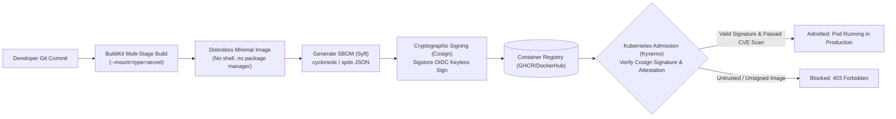
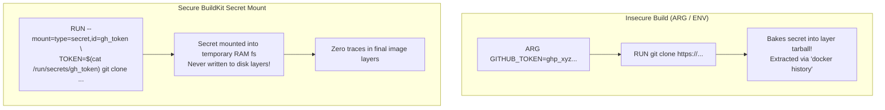
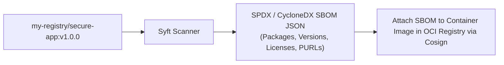
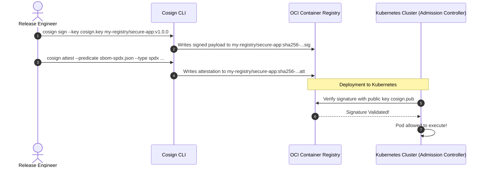

# Software Supply Chain Security: Distroless, SBOMs & Cosign Signing

Secure your container supply chain from source code commit to Kubernetes admission. Learn how to eliminate build secrets from image layers using **BuildKit secret mounts**, shrink attack surfaces with **Distroless** base images, generate comprehensive Software Bill of Materials (**SBOMs**) with Syft, and cryptographically sign and verify images using **Cosign** and Sigstore.



---

## 1. Hardened Dockerfile Design & BuildKit Secret Mounts

Never pass credentials (API keys, SSH keys, npm tokens) into `ARG` or `ENV` instructions: they are permanently baked into the image layer cache and readable with `docker history`.



### Production Multi-Stage Hardened Dockerfile

Create `Dockerfile`:

```dockerfile
# syntax=docker/dockerfile:1.4

# Stage 1: Build & Compile
FROM golang:1.22-alpine AS builder
WORKDIR /app

# Enable BuildKit cache mounts to accelerate dependency downloads
RUN --mount=type=cache,target=/go/pkg/mod \
    --mount=type=cache,target=/root/.cache/go-build \
    --mount=type=bind,source=go.mod,target=go.mod \
    --mount=type=bind,source=go.sum,target=go.sum \
    go mod download -x

# Mount secret safely during build without committing to layers
RUN --mount=type=secret,id=api_token \
    --mount=type=cache,target=/root/.cache/go-build \
    --mount=type=bind,source=.,target=. \
    CGO_ENABLED=0 GOOS=linux go build -ldflags="-w -s" -o /bin/server ./cmd/server

# Stage 2: Distroless Minimal Runtime (Zero shell, zero curl, zero package manager)
FROM gcr.io/distroless/static-debian12:nonroot
WORKDIR /
COPY --from=builder /bin/server /server

# Non-root user 65532 is pre-configured in distroless
USER nonroot:nonroot
EXPOSE 8080
ENTRYPOINT ["/server"]
```

Build with BuildKit:
```bash
DOCKER_BUILDKIT=1 docker build \
  --secret id=api_token,src=./secret_token.txt \
  -t my-registry/secure-app:v1.0.0 .
```

---

## 2. Generating Software Bill of Materials (SBOMs) with Syft

An **SBOM (Software Bill of Materials)** is a formal inventory of all software packages, libraries, dependencies, and transitive components contained within an artifact. It allows security teams to query whether a newly announced Zero-Day CVE (e.g. Log4j) affects their deployed containers in seconds.



### Step 2.1: Generate CycloneDX and SPDX SBOMs

```bash
# 1. Generate an SPDX JSON SBOM
syft my-registry/secure-app:v1.0.0 -o spdx-json=sbom-spdx.json

# 2. Generate a CycloneDX JSON SBOM
syft my-registry/secure-app:v1.0.0 -o cyclonedx-json=sbom-cyclonedx.json

# 3. Inspect package count and licenses detected
jq '.packages[] | {name: .name, version: .versionInfo, license: .licenseConcluded}' sbom-spdx.json | head -n 15
```

---

## 3. Cryptographic Image Signing with Cosign (Sigstore)

**Cosign** (part of the Linux Foundation's Sigstore project) cryptographically signs container images and stores signatures directly in the OCI container registry alongside the image manifest.



### Step 3.1: Generate Cosign Keypair

```bash
# Generate a cryptographic keypair
cosign generate-key-pair
# Generates: cosign.key (private key) and cosign.pub (public verification key)
```

### Step 3.2: Sign the Container Image

```bash
cosign sign --key cosign.key my-registry/secure-app:v1.0.0
```

### Step 3.3: Attach and Sign the SBOM Attestation

```bash
cosign attest --key cosign.key \
  --type spdxjson \
  --predicate sbom-spdx.json \
  my-registry/secure-app:v1.0.0
```

### Step 3.4: Verify Signature

```bash
cosign verify --key cosign.pub my-registry/secure-app:v1.0.0
```

Output:
```json
[
  {
    "critical": {
      "identity": {
        "docker-reference": "my-registry/secure-app"
      },
      "image": {
        "docker-manifest-digest": "sha256:d84f...c12"
      },
      "type": "cosign container image signature"
    }
  }
]
```

If anyone tampers with even a single bit of the container image in the registry, the digest verification fails instantly.

---

## Summary Checklist

- [x] Use `RUN --mount=type=secret` in multi-stage builds to prevent credential exposure in image layers.
- [x] Base production runtimes on **Distroless** images (`gcr.io/distroless/static`) to eliminate shells and attack surface.
- [x] Generate machine-readable **SBOMs** in SPDX or CycloneDX formats using Syft.
- [x] Cryptographically sign container images and attestations using **Cosign**.
- [x] Gate Kubernetes admissions by verifying Cosign signatures prior to scheduling workloads.

