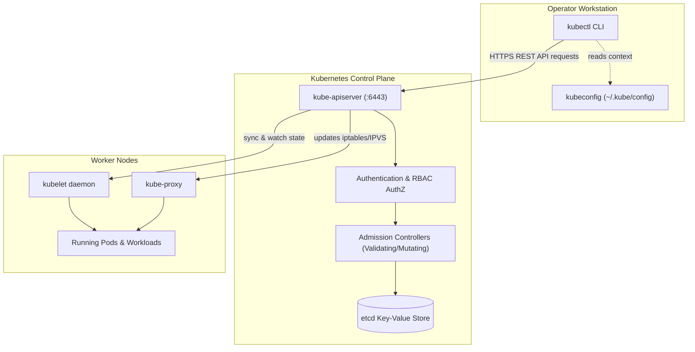
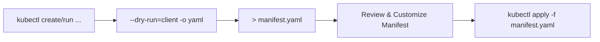
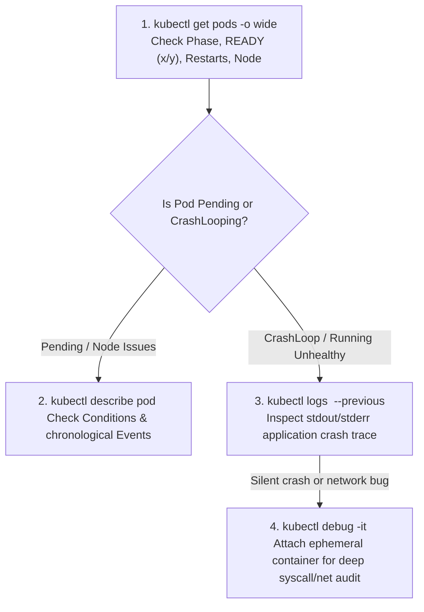
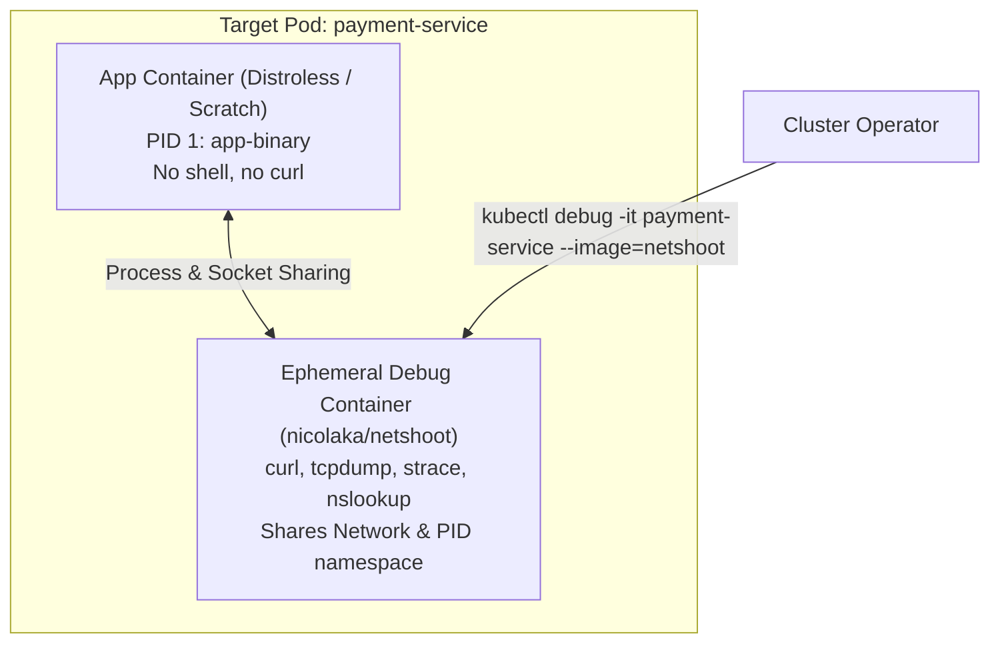
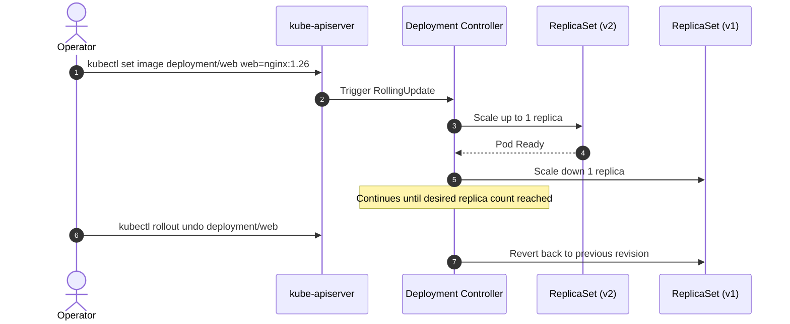

# kubectl Essentials & Production Operations Masterclass

Master daily Kubernetes administration and high-pressure incident response using `kubectl`. This hands-on lab takes you from core inspection workflows to advanced JSONPath queries, ephemeral container debugging, and rapid cluster recovery.



---

## 1. Context, Identity & Cluster Discovery

Before running any mutating operation, always verify where you are pointing and who you are authenticated as.

### Context Management

```bash
# Display the active context
kubectl config current-context

# List all available contexts in your kubeconfig
kubectl config get-contexts

# Switch rapidly between clusters or environments
kubectl config use-context staging-cluster

# Set the default namespace for the current context (saves typing -n every time)
kubectl config set-context --current --namespace=production
```

### Cluster Discovery & API Resources

Understand the cluster capabilities and short names:

```bash
# Print Kubernetes server and client versions
kubectl version --output=yaml

# Check cluster endpoints and CoreDNS health
kubectl cluster-info

# List all supported API resources, their short names, API groups, and namespaced status
kubectl api-resources --sort-by=name

# Inspect the exact specification and fields of any resource without opening a browser
kubectl explain deployment.spec.template.spec.containers.securityContext
```

---

## 2. Imperative Manifest Generation (The "Dry-Run" Superpower)

Never write boilerplate Kubernetes YAML by hand from scratch. Generate pristine manifests instantly with `kubectl --dry-run=client -o yaml`.



### Essential Generation Recipes

```bash
# 1. Standalone Pod with resource requests and environment variable
kubectl run backend-api --image=nginx:alpine --restart=Always \
  --port=8080 --env="ENV=production" \
  --dry-run=client -o yaml > pod-backend.yaml

# 2. Deployment with 3 replicas
kubectl create deployment web-app --image=nginx:1.25-alpine --replicas=3 \
  --dry-run=client -o yaml > deployment-web.yaml

# 3. ClusterIP Service exposing deployment
kubectl expose deployment web-app --port=80 --target-port=8080 --name=web-service \
  --dry-run=client -o yaml > service-web.yaml

# 4. ConfigMap from literal values and files
kubectl create configmap app-config \
  --from-literal=MAX_CONNS=1000 \
  --from-literal=LOG_LEVEL=info \
  --dry-run=client -o yaml > cm-app.yaml

# 5. Generic Secret from credentials
kubectl create secret generic db-credentials \
  --from-literal=username=dbadmin \
  --from-literal=password='S3cur3P@ssw0rd!' \
  --dry-run=client -o yaml > secret-db.yaml

# 6. Scheduled CronJob executing every 15 minutes
kubectl create cronjob log-purge --image=busybox:1.36 \
  --schedule="*/15 * * * *" \
  --dry-run=client -o yaml -- /bin/sh -c "echo Purging old logs; rm -rf /tmp/logs/*" > cronjob-purge.yaml

# 7. Batch Job with custom completion requirements
kubectl create job data-migrate --image=migrate-tool:v1 \
  --dry-run=client -o yaml > job-migrate.yaml
```

---

## 3. Systematic Workload Inspection & Diagnostics

When an incident triggers an alert, follow this strict 4-step diagnostic order: **Get -> Describe -> Events -> Logs**.



### Step 3.1: High-Level State (`kubectl get`)

```bash
# List all pods across all namespaces with node allocation and IP addresses
kubectl get pods -A -o wide

# Filter pods by label selector
kubectl get pods -l app=web-app,tier=frontend

# Sort pods by restart count to quickly identify unstable workloads
kubectl get pods -A --sort-by='.status.containerStatuses[0].restartCount'

# List deployments showing desired, current, up-to-date, and available replicas
kubectl get deployments -n default
```

### Step 3.2: Deep Object Examination (`kubectl describe`)

```bash
# Describe pod to see scheduling decisions, volume mounts, and probe failures
kubectl describe pod web-app-7b89f6d74-x9z2k

# Describe node to inspect allocatable resources, system conditions (MemoryPressure, DiskPressure), and taints
kubectl describe node worker-node-01
```

### Step 3.3: Cluster Events Timeline

```bash
# Stream chronological cluster events across all namespaces
kubectl get events -A --sort-by='.metadata.creationTimestamp'

# Filter warning events only (identifies evictions, image pull errors, probe timeouts)
kubectl get events --field-selector type=Warning -A
```

### Step 3.4: Application Logs Streaming

```bash
# View last 100 lines with timestamps
kubectl logs deployment/web-app --tail=100 --timestamps

# Follow logs in real-time
kubectl logs -f deployment/web-app

# Inspect logs of a specific container in a multi-container Pod
kubectl logs pod-multi-container -c sidecar-logger

# CRITICAL: Inspect logs of the PREVIOUS instance of a crashed container
kubectl logs pod-crashed-instance --previous
```

---

## 4. Troubleshooting Common Production Failures

### Failure Matrix

| Status | Root Cause | Immediate Diagnostic Command | Fix Action |
| :--- | :--- | :--- | :--- |
| **`ImagePullBackOff`** | Typo in tag, image does not exist, or missing private registry secret | `kubectl describe pod <name>` -> check `Events` | Correct image path, add `imagePullSecrets` |
| **`CrashLoopBackOff`** | App process exited with non-zero code, unhandled exception, bad arguments | `kubectl logs <name> --previous` | Fix application configuration or entrypoint |
| **`OOMKilled` (Exit 137)** | Container exceeded memory `limits.memory` | `kubectl describe pod <name> \| grep -i "oomkilled"` | Increase memory limit or fix memory leak |
| **`Pending`** | No node matches CPU/memory requests, taints without tolerations, PVC unbound | `kubectl describe pod <name>` -> check `FailedScheduling` | Add cluster capacity, fix taints, bind PVC |
| **`CreateContainerConfigError`** | Referenced ConfigMap or Secret does not exist or missing key | `kubectl get cm,secret` | Create missing ConfigMap or Secret |

### Hands-on Scenario: Diagnosing an OOMKilled Workload

```bash
# Inspect the termination state of the container
kubectl get pod memory-hog -o jsonpath='{range .status.containerStatuses[*]}{.name}{"\tExitCode: "}{.lastState.terminated.exitCode}{"\tReason: "}{.lastState.terminated.reason}{"\n"}{end}'
```

Output:
```text
app-container    ExitCode: 137    Reason: OOMKilled
```

Exit code `137` = `128 + 9 (SIGKILL)`. The Linux kernel Out-Of-Memory killer terminated the process because it exceeded the configured memory ceiling.

---

## 5. Ephemeral Containers for Zero-Impact Live Debugging

In production distroless images (e.g., `gcr.io/distroless/static`), there is no bash, sh, curl, or package manager inside the container. Use `kubectl debug` to inject an ephemeral diagnostic container sharing the target pod's process and network namespaces.



```bash
# Attach an interactive netshoot container to a running pod
kubectl debug -it pod/web-app-7b89f6d74-x9z2k \
  --image=nicolaka/netshoot \
  --target=web-app \
  -- /bin/bash

# Inside the netshoot container, test internal service connectivity:
# nslookup payment-db.default.svc.cluster.local
# curl -Iv http://127.0.0.1:8080/healthz
# ss -tulpn
```

---

## 6. Advanced JSONPath & Custom Columns for Rapid Auditing

JSONPath allows extracting targeted values from raw API responses without external parsing utilities.

### Essential JSONPath One-Liners

```bash
# 1. Extract all Node IPs (Internal and External)
kubectl get nodes -o jsonpath='{range .items[*]}{.metadata.name}{"\t"}{range .status.addresses[?(@.type=="InternalIP")]}{.address}{end}{"\n"}{end}'

# 2. List all unique container images running across the entire cluster
kubectl get pods -A -o jsonpath='{range .items[*].spec.containers[*]}{.image}{"\n"}{end}' | sort -u

# 3. Find all Pods that have been restarted more than 5 times
kubectl get pods -A -o custom-columns=NAMESPACE:.metadata.namespace,NAME:.metadata.name,RESTARTS:.status.containerStatuses[0].restartCount \
  --sort-by='.status.containerStatuses[0].restartCount'

# 4. View all Pods scheduled on a specific node
kubectl get pods -A --field-selector spec.nodeName=worker-node-01

# 5. Extract the base64-decoded value of a Secret key in a single command
kubectl get secret db-credentials -o jsonpath='{.data.password}' | base64 --decode; echo
```

---

## 7. Operational Traffic Control & Rollouts

### Managing Rollouts



```bash
# Inspect rollout history with revisions
kubectl rollout history deployment/web-app

# Check live rollout status with timeout safeguard
kubectl rollout status deployment/web-app --timeout=60s

# Pause a rollout to perform canary verification
kubectl rollout pause deployment/web-app

# Resume the rollout after verification
kubectl rollout resume deployment/web-app

# Perform an immediate rollback to the previous revision
kubectl rollout undo deployment/web-app

# Roll back to a specific revision number
kubectl rollout undo deployment/web-app --to-revision=2

# Trigger a zero-downtime rolling restart (re-creates pods without config changes)
kubectl rollout restart deployment/web-app
```

### Port Forwarding and Remote Execution

```bash
# Forward local port 9090 to a service in the cluster
kubectl port-forward svc/prometheus-k8s 9090:9090 -n monitoring

# Forward local port 8080 directly to a pod
kubectl port-forward pod/web-app-7b89f6d74-x9z2k 8080:80

# Execute interactive shell inside a running container
kubectl exec -it web-app-7b89f6d74-x9z2k -- /bin/sh

# Copy a configuration file or heap dump from a pod to your local machine
kubectl cp default/web-app-7b89f6d74-x9z2k:/tmp/heapdump.hprof ./heapdump.hprof
```

---

## 8. Node Maintenance Operations

Safe cluster operations require draining workloads gracefully before taking nodes offline for kernel upgrades or hardware maintenance.

```bash
# 1. Mark node as unschedulable (no new pods will be scheduled on this node)
kubectl cordon worker-node-02

# 2. Evict existing pods gracefully, ignoring DaemonSets and giving pods 60s to terminate
kubectl drain worker-node-02 --ignore-daemonsets --delete-emptydir-data --grace-period=60

# 3. Perform maintenance on worker-node-02...

# 4. Uncordon the node to allow scheduling again
kubectl uncordon worker-node-02
```

---

## 9. Hands-on Verification Lab

### Exercise 1: Imperative Debug Challenge

1. Create a namespace named `diag-lab`:
   ```bash
   kubectl create ns diag-lab
   ```
2. Imperatively deploy an intentionally broken Pod:
   ```bash
   kubectl run broken-pod --image=busybox:1.36 -n diag-lab -- /bin/sh -c "exit 1"
   ```
3. Run `kubectl get pods -n diag-lab` and observe `CrashLoopBackOff`.
4. Inspect the exit code using JSONPath:
   ```bash
   kubectl get pod broken-pod -n diag-lab -o jsonpath='{.status.containerStatuses[0].lastState.terminated.exitCode}'
   ```
5. Clean up the laboratory namespace:
   ```bash
   kubectl delete ns diag-lab
   ```

---

## Summary Checklist

- [x] Use `kubectl config set-context --current --namespace=<ns>` to prevent accidental cross-namespace mistakes.
- [x] Always use `--dry-run=client -o yaml` to author accurate Kubernetes manifests.
- [x] Follow the **Get -> Describe -> Events -> Logs** systematic debugging sequence.
- [x] Use `kubectl logs -p` (`--previous`) when debugging container crashes and restarts.
- [x] Utilize `kubectl debug` with ephemeral containers for zero-impact troubleshooting in distroless environments.
- [x] Execute `cordon` and `drain --ignore-daemonsets` before any node-level maintenance.
